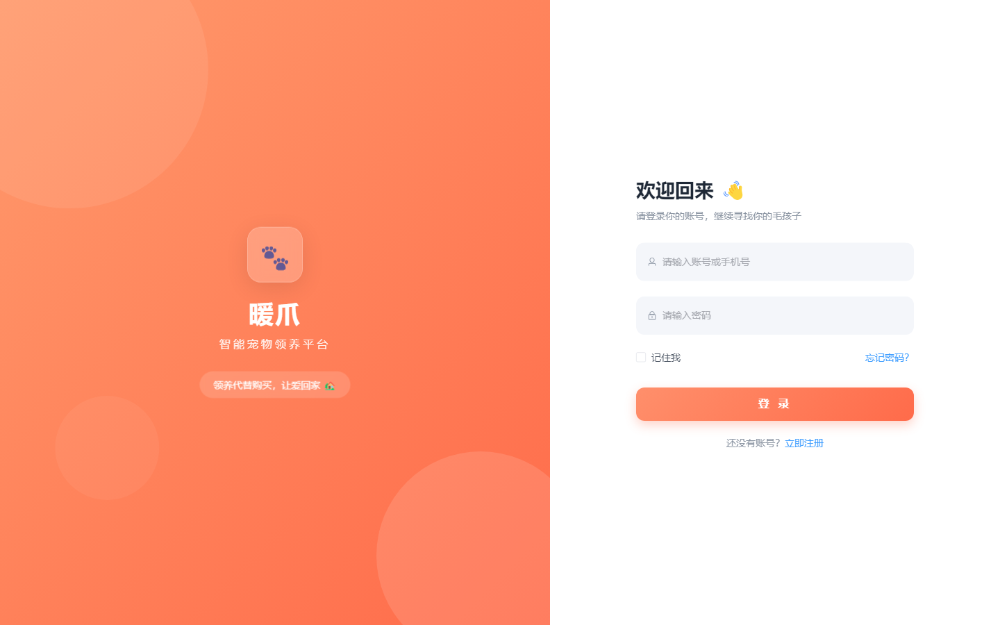
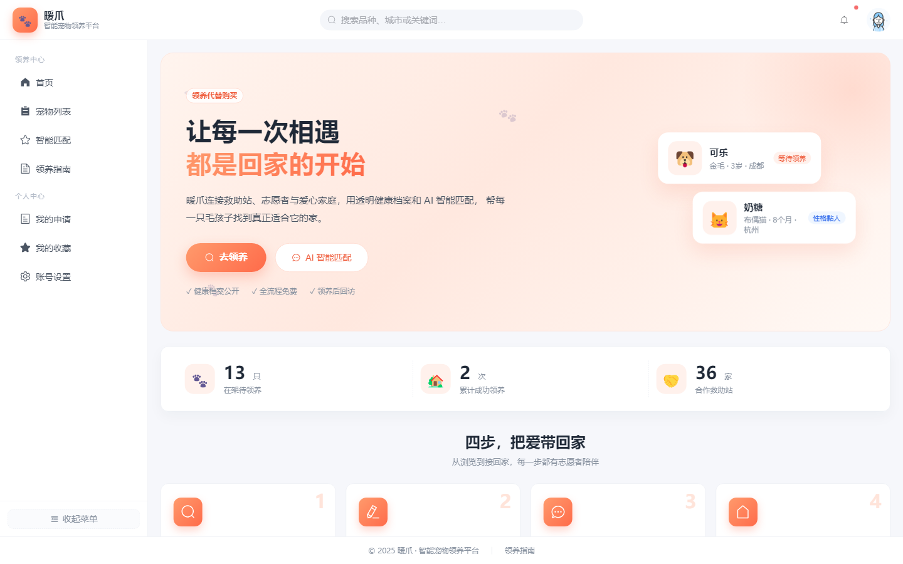
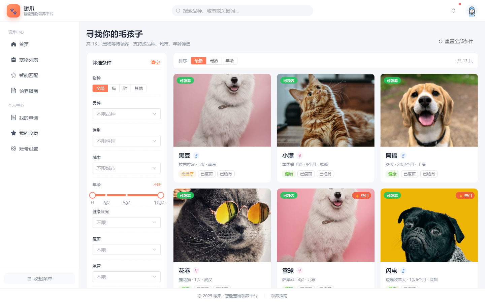
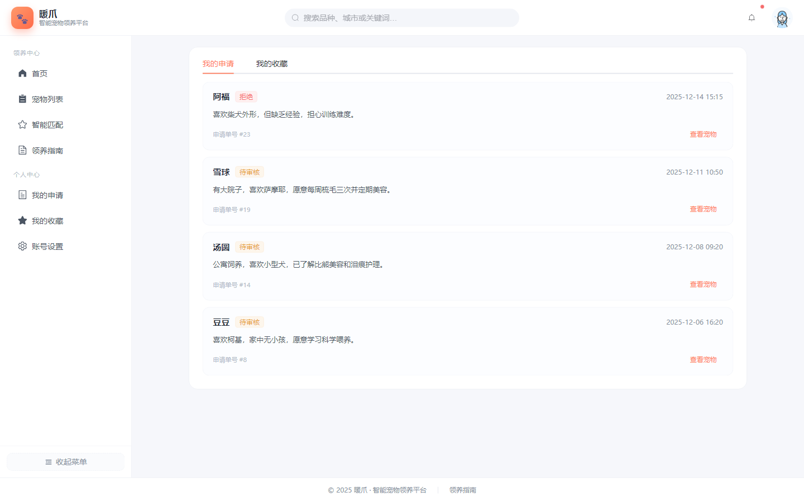
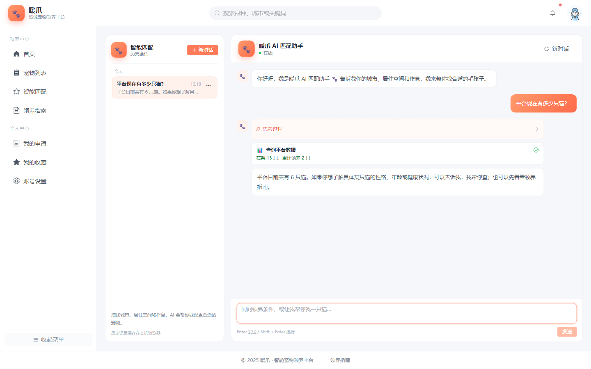
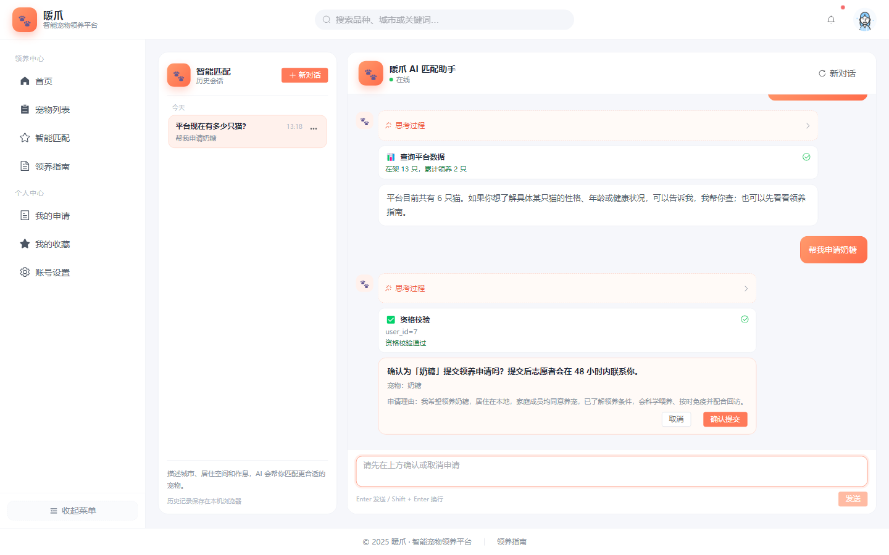
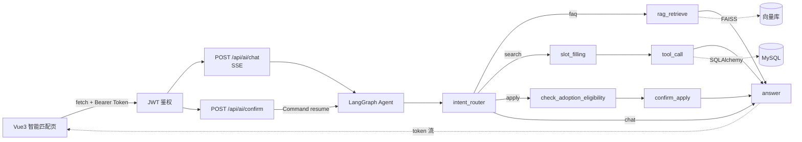

# 🐾 暖爪 · 智能宠物领养平台

> 一个面向公益救助场景的全栈宠物领养平台：FastAPI + Vue 3 + MySQL，内置 **RAG 知识库**、**Tool Calling** 与 **LangGraph 智能领养 Agent**。

[](https://www.python.org/)
[](https://fastapi.tiangolo.com/)
[](https://vuejs.org/)
[](https://www.mysql.com/)
[](.github/workflows/ci.yml)
[](LICENSE)

---

## ✨ 项目亮点

- **完整业务闭环**：注册登录 → 浏览筛选 → 收藏 → 提交领养申请 → 查看申请进度。
- **AI 智能匹配助手**：SSE 流式输出，结合 RAG 检索、平台工具调用与 LangGraph 状态机，支持二次确认提交申请。
- **数据看板与领养指南**：首页实时统计在架 / 已领养数量，FAQ 分组展示。
- **工程化细节**：统一响应格式、全局异常处理、JWT 鉴权、bcrypt 密码加密、日志落盘、CORS 与静态资源托管。
- **可验证**：内置宠物 / FAQ 种子数据、知识库建库脚本、AI 工具单元测试与知识库切分测试。

## 🧱 技术栈

| 层次 | 技术 |
|---|---|
| 后端 | FastAPI、SQLAlchemy 2.0、Pydantic v2、PyMySQL、PyJWT、bcrypt、loguru |
| AI | LangChain、LangGraph、FAISS、OpenAI 兼容接口、SSE（sse-starlette） |
| 前端 | Vue 3、Vue Router、Element Plus、axios、Vite |
| 数据库 | MySQL 8.0（UTF-8MB4） |

## 📸 项目展示

### 全栈业务界面



> 登录页：品牌展示 + 表单校验 + JWT 登录，登录后进入管理端。



> 首页：品牌 Hero、实时数据看板、四步领养流程、周期推荐与成功案例。



> 宠物列表：按物种、品种、性别、城市、年龄、健康 / 疫苗 / 绝育筛选，支持最新 / 最热 / 年龄排序。



> 个人中心：我的领养申请进度与收藏的宠物，数据来自 `/api/adoption/*` 接口。

### AI 智能领养 Agent



> Tool Calling：用户提问“平台现在有多少只猫”，LangGraph 调用 `get_platform_stats`，
> 前端展示工具卡片，SSE 逐字流式输出回答。



> 二次确认：识别 `apply` 意图后先做资格校验，通过后弹出确认卡片；
> 用户点击“确认提交”前不会写入数据库。

## 🗂 目录结构

```text
python-vue-agent/
├── python-agent/                 # 后端
│   ├── app/
│   │   ├── ai/                   # 向量库、检索器、工具集、LangGraph、SSE 封装
│   │   ├── api/                  # login / register / user / file / pet / stats / adoption / guide / ai
│   │   ├── core/                 # 配置、日志、响应、数据库、异常、LLM
│   │   ├── dependencies/         # JWT 当前用户依赖
│   │   ├── models/               # User / Pet / AdoptionApplication / Favorite / GuideFaq
│   │   ├── schemas/              # 请求与响应模型
│   │   ├── services/             # 业务逻辑
│   │   ├── utils/                # JWT、bcrypt
│   │   └── main.py               # 应用入口
│   ├── docs/
│   │   ├── knowledge_base_schema.md
│   │   └── kb/                   # RAG 语料（4 篇）
│   ├── scripts/                  # seed_pets / seed_guide / build_vectorstore
│   ├── tests/                    # 工具与知识库切分测试
│   ├── requirements.txt
│   └── .env.example
├── vue-frontend/                 # 前端
│   └── src/
│       ├── api/                  # 按业务拆分的接口
│       ├── components/           # AiChat、ChatHistory、PetCard 等
│       ├── views/                # Home / Pet / PetDetail / Guide / Match / My / User / Login / Register
│       └── utils/                # axios、token、历史会话
├── docs/
│   └── screenshots/              # README 项目展示图
├── LICENSE
└── README.md
```

## 🚀 快速开始

### 0. 环境要求

- Python 3.10 – 3.12（FAISS 暂不支持 3.13+）
- Node.js 18+（推荐 20 / 22）
- MySQL 8.0+
- 一个兼容 OpenAI 协议的对话模型服务；RAG 还需要一个支持 **Embedding** 的服务

### 1. 创建数据库

```sql
CREATE DATABASE pet_agent DEFAULT CHARSET utf8mb4 COLLATE utf8mb4_unicode_ci;
```

### 2. 启动后端

```bash
cd python-agent

python -m venv .venv
# Windows
.venv\Scripts\activate
# macOS / Linux
source .venv/bin/activate

pip install -r requirements.txt

# 复制配置并填写数据库、模型密钥
copy .env.example .env        # Windows
cp .env.example .env          # macOS / Linux

uvicorn app.main:app --reload --port 8080
```

首次启动会自动建表（`Base.metadata.create_all`）。接口文档：<http://127.0.0.1:8080/docs>。

### 3. 写入种子数据

```bash
# 宠物数据（14 条，其中 2 条已领养）
python scripts/seed_pets.py

# 领养指南 FAQ（12 条）
python scripts/seed_guide.py
```

### 4. 构建 RAG 向量库

```bash
python scripts/build_vectorstore.py
```

成功后生成 `data/vectorstore/index.faiss` 与 `index.pkl`。修改 `docs/kb/` 或更换
`EMBEDDING_MODEL` 后必须重新执行，否则检索失效或维度不匹配。

### 5. 启动前端

```bash
cd vue-frontend
npm install
npm run dev
```

访问 <http://127.0.0.1:5173>。Vite 已把 `/api` 与 `/uploads` 代理到 `127.0.0.1:8080`。

> 没有账号时先访问 `/register` 注册；登录后即可体验 AI 匹配、收藏与领养申请。

## 🔐 环境变量

后端配置位于 `python-agent/.env`（已被 `.gitignore` 忽略，仓库只提交 `.env.example`）。

| 变量 | 说明 | 示例 |
|---|---|---|
| `DB_HOST` / `DB_PORT` | MySQL 地址与端口 | `localhost` / `3306` |
| `DB_NAME` / `DB_USER` / `DB_PASSWORD` | 数据库名与账号 | `pet_agent` / `root` / `******` |
| `SERVER_PORT` | 后端端口 | `8080` |
| `CORS_ORIGINS` | 允许的前端来源，逗号分隔 | `http://localhost:5173` |
| `TOKEN_SECRET` | JWT 密钥，生产环境务必替换 | 随机 64 位字符串 |
| `TOKEN_EXPIRE_HOURS` | Token 有效期（小时） | `24` |
| `LLM_API_KEY` | 对话模型密钥 | `sk-******` |
| `LLM_BASE_URL` | 兼容 OpenAI 的接口地址 | `https://api.deepseek.com` |
| `LLM_MODEL` | 对话模型 | `deepseek-chat` |
| `EMBEDDING_PROVIDER` | `openai` 或 `huggingface` | `openai` |
| `EMBEDDING_API_KEY` / `EMBEDDING_BASE_URL` | 向量服务密钥与地址，留空则复用 LLM | — |
| `EMBEDDING_MODEL` | 向量模型，建库与检索必须一致 | `text-embedding-3-small` |
| `VECTOR_STORE_DIR` | 向量库目录 | `./data/vectorstore` |
| `RAG_TOP_K` / `RAG_SCORE_THRESHOLD` | 召回条数与相似度阈值 | `4` / `0.35` |
| `AI_SESSION_TTL_MINUTES` | 会话空闲多久后清理 | `30` |

> **关于 Embedding**：DeepSeek 只提供对话接口，不提供 Embedding。演示 RAG 时请把
> `EMBEDDING_API_KEY` / `EMBEDDING_BASE_URL` / `EMBEDDING_MODEL` 指向支持向量化的服务
> （如硅基流动的 `BAAI/bge-m3`、阿里云百炼的 `text-embedding-v3`、OpenAI 的
> `text-embedding-3-small`），或使用本地模式：
>
> ```bash
> pip install -r requirements-local-embed.txt
> # .env
> EMBEDDING_PROVIDER=huggingface
> EMBEDDING_MODEL=BAAI/bge-small-zh-v1.5
> ```

## 🧠 AI 助手架构



### SSE 事件协议

| 事件 | 时机 | 示例 |
|---|---|---|
| `meta` | 会话开始 | `{"session_id":"a1b2c3"}` |
| `intent` | 意图识别完成 | `{"intent":"search"}` |
| `retrieval` | RAG 完成 | `{"sources":[{"title":"领养条件与申请流程","score":0.86}]}` |
| `tool_start` / `tool_end` | 工具调用 | `{"tool":"search_pets","args":{"species":"猫"}}` |
| `token` | 逐字输出 | `{"content":"你"}` |
| `confirm` | 需要二次确认 | `{"action":"submit_adoption","pet_id":1}` |
| `done` / `error` | 结束 / 异常 | `{"duration_ms":1234}` |

### 关键设计

- **工具权限**：`user_id` 从 JWT 解出，工具入参中的 `user_id` 会与 token 比对，伪造直接拒绝。
- **二次确认**：`submit_adoption_intent` 未确认前只返回确认指令，不写库；只有用户点击确认后，`confirm_apply` 节点才会调用 `submit_confirmed`。
- **RAG 兜底**：向量库不存在、无召回或相似度低于阈值时，直接返回固定兜底文案，不调用大模型。
- **会话隔离**：`thread_id = user_id:session_id`，由 LangGraph `MemorySaver` 保存多轮上下文，空闲超过 `AI_SESSION_TTL_MINUTES` 自动清理。

## 📡 主要接口

| 方法 | 路径 | 说明 | 鉴权 |
|---|---|---|---|
| POST | `/api/register` | 注册 | 否 |
| POST | `/api/login` | 登录，返回 JWT + 用户信息 | 否 |
| GET | `/api/user/info` | 当前用户信息 | 是 |
| PUT | `/api/user/update` | 修改个人资料 | 是 |
| POST | `/api/files/upload` | 上传头像 / 图片 | 是 |
| GET | `/api/pet/list` | 宠物分页列表与筛选 | 否 |
| GET | `/api/pet/recommend` | 首页推荐 | 否 |
| GET | `/api/pet/{pet_id}` | 宠物详情 | 否 |
| GET | `/api/stats/overview` | 首页数据看板 | 否 |
| GET | `/api/guide/faq` | 领养指南 FAQ | 否 |
| POST | `/api/adoption/apply` | 提交领养申请 | 是 |
| GET | `/api/adoption/apply/my` | 我的申请 | 是 |
| POST | `/api/adoption/favorite` | 收藏 / 取消收藏 | 是 |
| GET | `/api/adoption/favorite/list` | 我的收藏 | 是 |
| POST | `/api/ai/chat` | AI 对话（SSE） | 是 |
| POST | `/api/ai/confirm` | 二次确认（SSE） | 是 |
| GET | `/api/ai/health` | AI 配置与向量库自检 | 否 |

## 🧪 测试

```bash
cd python-agent
python -m unittest discover -s tests -v
```

覆盖工具查询、越权拦截、二次确认、资格校验、知识库 Front Matter 解析与切分规则。
测试使用 SQLite 内存库，不依赖 MySQL；如需 pytest，可先 `pip install -r requirements-dev.txt`，
再执行 `pytest tests -v`（pytest 同样能收集这些 unittest 用例）。

## 🎬 演示脚本

1. 打开 `/manager/home`，查看数据看板与「本周期待回家」推荐。
2. 进入 `/manager/pets`，筛选“猫 + 杭州 + 0-24 月”，进入详情收藏并申请。
3. 进入 `/manager/match`，依次输入：
   - `领养需要封窗吗？` → `retrieval` 来源卡片 + 流式回答
   - `有没有 2 岁的布偶猫？` → `search_pets` 工具卡片
   - `平台现在有多少只猫？` → `get_platform_stats`
   - `帮我申请奶糖` → `confirm` 卡片；点击确认后生成申请单号
   - `你们能上门帮我训狗吗？` → 知识库无命中，转人工兜底
4. 左侧历史会话支持新建、切换、重命名、删除，刷新页面后仍然保留。

## 🛠 常见问题

| 现象 | 排查方向 |
|---|---|
| 启动后数据库没有新表 | 确认 `main.py` 已 `import app.models`，删除 `__pycache__` 后重启 |
| AI 回复“没有找到确切答案” | 是否执行过 `build_vectorstore.py`；`EMBEDDING_MODEL` 是否与建库一致 |
| 前端一次性输出整段回答 | 检查是否有 GZip / Nginx `proxy_buffering`；本项目默认关闭压缩并设置 `X-Accel-Buffering: no` |
| 401 未登录 | 请求头是否为 `Authorization: Bearer <token>`；CORS 白名单是否包含前端地址 |
| `faiss-cpu` 安装失败 | 使用 Python 3.10–3.12；Windows 直接装官方 wheel，不要源码编译 |
| `interrupt() requires a checkpointer` | 必须通过 `get_graph()` 获取带 `MemorySaver` 的图，并传 `thread_id` |

更完整的报错说明见 [`python-agent/docs/knowledge_base_schema.md`](python-agent/docs/knowledge_base_schema.md)
与代码内注释。

## 📦 部署建议

- 生产环境将 `TOKEN_SECRET`、数据库密码、模型密钥放入环境变量或密钥管理服务，**不要提交 `.env`**。
- `Base.metadata.create_all` 仅适合演示；生产建议引入 Alembic 迁移。
- SSE 路径（`/api/ai/`）需要关闭反向代理缓冲，并调大 `proxy_read_timeout`：

```nginx
location /api/ai/ {
    proxy_pass http://127.0.0.1:8080;
    proxy_http_version 1.1;
    proxy_set_header Host $host;
    proxy_set_header Connection "";
    proxy_buffering off;
    proxy_cache off;
    proxy_read_timeout 300s;
    proxy_send_timeout 300s;
}
```

- `MemorySaver` 为进程内记忆，多进程 / 重启会丢失；可替换为
  `langgraph-checkpoint-postgres` 或 Redis 实现。

## 📄 License

[MIT](LICENSE) © 2026 暖爪项目组

> 宠物图片来自 Unsplash，仅用于演示；知识库文案为项目原创示例，不构成医疗建议。

---

> 第一次上传到 GitHub？见 [docs/GITHUB_UPLOAD.md](docs/GITHUB_UPLOAD.md)（含网页建仓、命令行推送、Token 与常见报错说明）。
